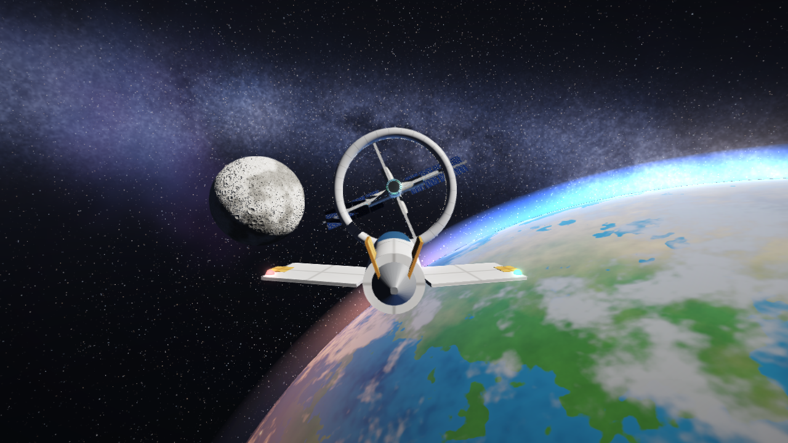
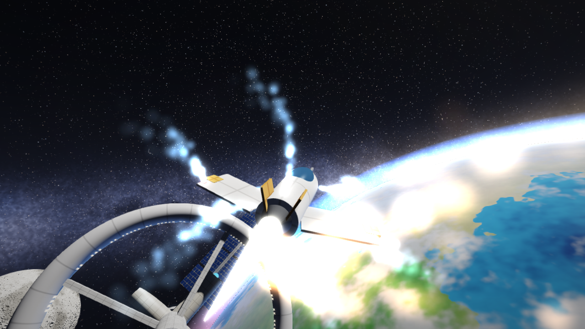
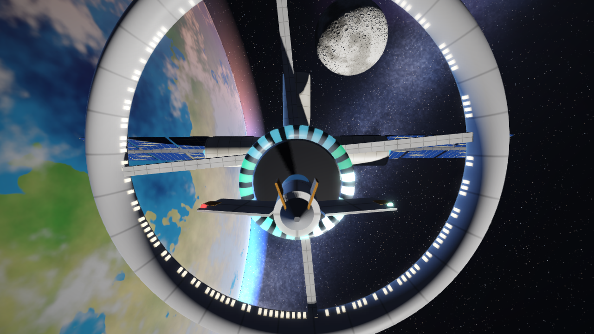
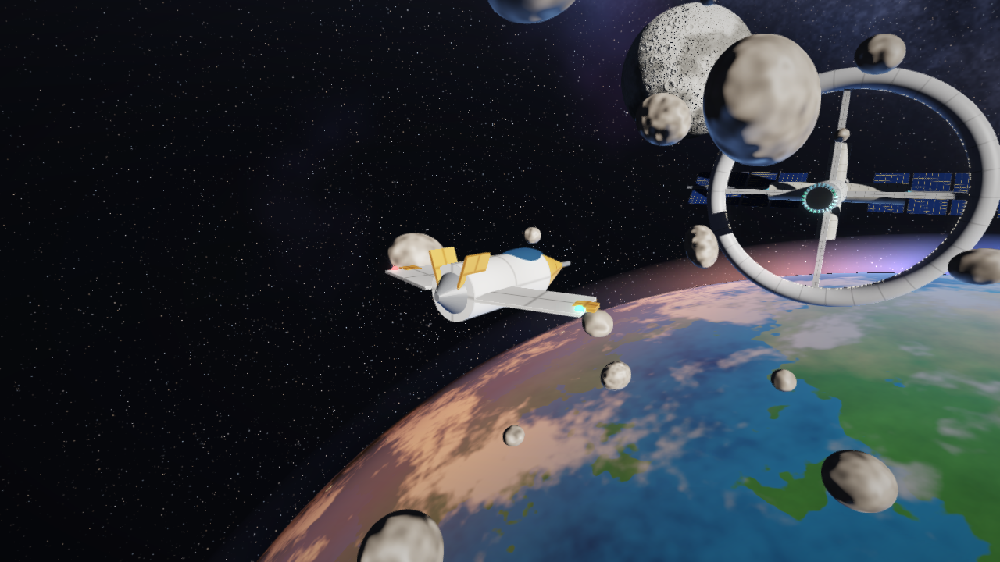
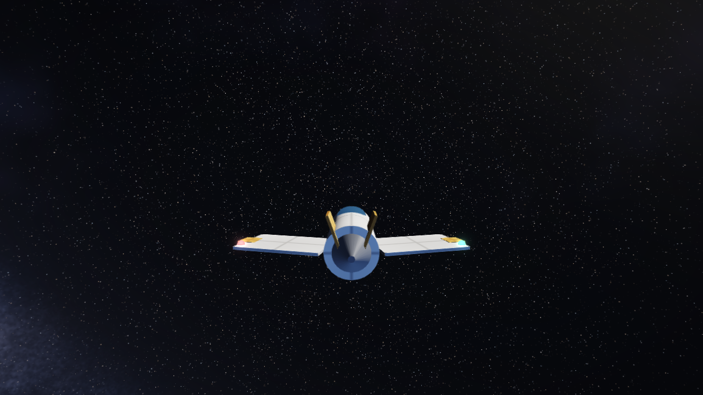

# Orbital Dock 3D — Space Station Docking Simulator

**Author:** Sami Khan · [LinkedIn](https://www.linkedin.com/in/samikhan07) · [GitHub](https://github.com/samikhan7507)



Pilot a spacecraft with full **6-DOF** control (3 translations + 3 rotations), approach a **spinning, wobbling space station** in front of a procedural Earth, Moon and Milky Way, match its rotation and dock.
Everything is **C++17 + OpenGL ES 3.0 / GLSL** with a **hand-written math library (Vec3, Mat4, Quaternion — no GLM, no engine, no image assets)**. It runs in any modern browser on **phone or laptop** (WebAssembly) and natively on desktop. 100 % free.

| | |
|---|---|
|  |  |
| RCS thruster particles, engine flame, bloom | Docked: shadow-mapped ring, guide lights |
|  |  |
| Level 4: debris field | Gimbal-lock lab pose (nose straight up) |

---

## 1. Quick start

### Browser (easiest)
`build_web/` already contains a ready-to-run build.
```bash
python3 serve.py            # open http://localhost:8000
```
`serve.py` also prints a LAN address: open it on your phone (same Wi-Fi) for touch controls.
WebAssembly needs `http://`, so double-clicking `index.html` will not work.
**Free public link for your teacher:** upload the *contents* of `build_web/` to a GitHub repository → Settings → Pages → deploy from branch.

### Rebuild the web version
Install the [Emscripten SDK](https://emscripten.org/docs/getting_started/downloads.html), then `./build_web.sh` (Windows: `build_web.bat` from an emsdk shell).

### Native desktop (needs OpenGL 3.3)
```bash
sudo apt install build-essential libglfw3-dev pkg-config     # macOS: brew install glfw
./build_native.sh && ./build_native/orbitaldock
```
or CMake (downloads GLFW automatically if missing — use this on Windows):
```bash
cmake -B build -DCMAKE_BUILD_TYPE=Release && cmake --build build --config Release
```
The native build shows a one-line HUD in the window title; the full graphical HUD, menu, sound and touch controls are in the web build.

### Self-tests (no GPU needed)
```bash
g++ -std=c++17 -O2 -Isrc tools/test_physics.cpp -o test_physics && ./test_physics
```
Runs 32 checks: matrix inverse, quaternion rotation, SLERP, multiplication order, thrust physics, Newtonian rotation, gimbal-lock proof, every docking outcome, scoring, replay, ghost, debris collisions, and **the autopilot docking 5/5 times on each of the 4 levels**.

---

## 2. Controls

| Action | Keyboard / mouse | Touch | Gamepad |
|---|---|---|---|
| Move fwd/back, left/right | `W S A D` | left stick | left stick |
| Up / down | `R F` | UP / DOWN | D-pad ↑ ↓ |
| Pitch / yaw | arrows or **mouse drag** | right stick | right stick |
| Roll | `Q E` | ↶ ↷ | LB / RB |
| Brake / stop spin | `Z`·`Space` / `X` | BRAKE / STOP | A / – |
| Flight assist | `V` | ASSIST | B |
| Camera (cockpit·chase·orbit·tracking) | `C` | CAM | Y |
| **Autopilot** | `P` | AUTO | Back |
| **Euler ⇄ Quaternion** · **jump to lock pose** | `G` · `L` | ☰ menu | – |
| Replay last run · ghost on/off | `Y` · `O` | ☰ menu | – |
| Level 1-4 · New run | `1`-`4` · `N` | ☰ menu · NEW | Start |
| Inspector · Bloom · Sound · Help · Menu | `T` `B` `M` `H` `Tab` | buttons | – |

**Goal:** centre on the glowing port, match the station's spin, touch down below 1.5 m/s with tilt < 8° and roll error < 10°. The ALIGN / SPEED / ATTITUDE / ROLL lights turn green when each condition holds. *Flight assist* is a **sync assist**: near the station it damps your rotation relative to the station's spin, so you only have to line up; switch it off (`V`) to do the roll matching yourself.

---

## 3. Features

**Flight and gameplay**
- Newtonian 6-DOF flight: thrust persists, you brake by thrusting back; fuel; flight assist
- 4 levels — **Easy**, **Normal**, **Hard** (fast spin + wobbling axis, "tumble"), **Debris** (26 drifting rocks) — with score multipliers
- Docking checklist, soft-capture blend, crash detection (hull, ring, spokes, modules, truss, rocks)
- **Scoring** (docking + time + fuel + precision, × level, × ½ with autopilot), grades S/A/B/C, best score per level (saved in your browser)
- **Autopilot docking:** commanded attitude is **SLERPed** to the docking attitude and tracked by a PD controller; position follows a velocity funnel in the station frame; it avoids rocks. Any manual input takes the controls back
- **Replay** of your last run (free camera) and a **ghost** hologram of your best run racing with you

**Computer-graphics showpieces**
- **Gimbal-lock lab:** press `G` to fly with Euler angles instead of quaternions, `L` to jump to pitch 88°, then try yaw and roll — they do the same thing (the HUD says so). Press `G` again: quaternions have no such problem
- **Transform Inspector** (`T`): live 4×4 model matrix and quaternion of your ship
- **Sun shadow mapping** (PCF), **bloom** (bright-pass + two-level Gaussian), **FXAA**, vignette, ACES tone mapping
- **GPU-style particles:** RCS puffs fire from the physically correct nozzle for every translation/rotation command; exhaust keeps the ship's inertia
- Fully procedural Earth (continents, ice, drifting clouds, night-side city lights, ocean glint, atmosphere), cratered Moon with analytic normals, Milky Way with dust lanes, nebulae, twinkling stars, Sun, asteroids

**Platform**
- Sound synthesised live with the Web Audio API (engine, thrusters, proximity beeps, docking chime, crash)
- Mouse, keyboard, touch, gamepad; responsive HUD for phones; adaptive pixel density and shadow resolution on mobile

---

## 4. Where each CG concept lives

| Concept | Where |
|---|---|
| Translation / rotation / scaling matrices | `src/math/mat4.h` (`translate`, `rotate` — Rodrigues, `scale`); flame length scales with thrust (`renderer.cpp: drawShip`) |
| Matrix multiplication order | `Mat4::operator*`; proven by a test (`T·R ≠ R·T`) |
| Hierarchical transforms | Station → ring → spokes; ship → wings/nozzle/flame (`drawStation`, `drawShip`); docked ship = child of the station (`game.h`) |
| Local vs world space | Thrust in ship axes rotated to world (`spacecraft.h`); autopilot works in the *station* frame (`autopilot.h`) |
| Quaternions, no gimbal lock | `src/math/quat.h`; orientation integrated as `q · axisAngle(ω·dt)` |
| **Gimbal lock** | `src/game/euler.h` + Euler mode in `spacecraft.h`; proven in `tools/test_physics.cpp` |
| SLERP | Chase camera (`camera.h`), autopilot attitude trajectory (`autopilot.h`), docking blend, replay & ghost interpolation (`game.h`) |
| Swing–twist decomposition | Roll error about the docking axis (`station.h: evaluate`) |
| Camera / view matrix | `Mat4::lookAt` |
| Perspective & orthographic projection | `Mat4::perspective` (two depth ranges, far + near pass) · `Mat4::ortho` (Sun shadow map) |
| Model–View–Projection | `uVP * uModel * vertex`, `shaders.h: VERT` |
| Normal matrix | `Mat4::normalMatrix3` = transpose(inverse(M₃ₓ₃)) |
| Inverse matrix | `Mat4::inverse` — normal matrix, sky ray reconstruction, Moon object-space lighting |
| Blinn-Phong lighting, earthshine, rim light | `LIT_FRAG` |
| **Shadow mapping** | `Renderer::shadowPass`, `shadowFactor()` in `LIT_FRAG` (depth texture, bias, 3×3 PCF) |
| Render-to-texture / post-processing | `scene_` FBO, `postPass`: bright pass, separable Gaussian blur, composite |
| Anti-aliasing | FXAA in `COMPOSITE_FRAG` |
| Point sprites, additive blending | `PART_VERT/FRAG`, atmosphere shell (`ATMO_FRAG`) |
| Procedural texturing | value-noise fBm, cellular craters, star cells (`COMMON`, `SKY_FRAG`, `MOON_FRAG`) |
| Tone mapping + gamma | ACES in `finalColor()` |
| Collision detection | Spheres vs capsule / torus / boxes / rocks (`station.h`, `game.h`) |
| Rigid-body kinematics | `omega × r` velocity of the docking probe on a spinning station (`station.h`) |

### Likely viva questions (short answers)
- **Why quaternions?** No gimbal lock, 4 numbers instead of 9, cheap to renormalise, and SLERP interpolates at constant angular speed.
- **What is gimbal lock?** With Euler angles, when pitch = ±90° the yaw axis and roll axis line up, one rotational degree of freedom disappears. Try it with `G` then `L`.
- **MVP pipeline?** Model → world, View → camera at origin, Projection → clip space; the GPU divides by *w*.
- **Normal matrix?** `transpose(inverse(M₃ₓ₃))`; plain `M` skews normals under non-uniform scale.
- **Why does multiplication order matter?** `T·R` rotates then moves; `R·T` moves then orbits.
- **How does shadow mapping work?** Render depth from the Sun with an orthographic camera; when shading, transform each point into light space and compare its depth with the stored depth.
- **Why two render passes?** One depth buffer cannot cover 0.1 m and 6000 m precisely; far scene first, clear depth, then the near scene.
- **How does bloom work?** Only "glowing" pixels (flagged in the alpha channel) are extracted, blurred at ½ and ¼ resolution and added back.
- **How does the autopilot rotate smoothly?** It SLERPs a commanded orientation at constant angular speed, and a PD controller makes the ship follow it.

---

## 5. Project layout
```
src/math/     vec3.h  mat4.h  quat.h                          own linear algebra
src/engine/   gfx  shader  mesh  shaders.h  renderer          GL layer, procedural meshes, all GLSL, 4 render stages
src/game/     spacecraft station camera game autopilot particles euler    physics, rules, levels, replay
src/main.cpp  loop, input, touch/gamepad bridge               src/hud.cpp  telemetry -> HTML HUD
web/shell.html  HUD, menu, score screen, audio, gamepad       build_web/   ready-to-run web build
tools/test_physics.cpp  32 self-tests                         docs/        screenshots
```

---

## 6. Honest testing notes
**Verified here:** native rendering with software OpenGL 3.3 (every screenshot in `docs/` except the HUD ones), 32/32 self-tests including 20/20 autopilot dockings, WebAssembly build compiles, loads in Firefox and exports its control functions, and the full HUD / menu / score / replay / sound code ran in Firefox against synthetic telemetry with zero JavaScript errors (HUD screenshots).
**Not verified in my environment:** the 3D scene running *inside a browser* (the sandbox browser had no WebGL2), real phone touch, real gamepad hardware, audible sound quality, and frame rate on real GPUs. The shaders are the same code that rendered natively; please run it once on your devices before the demo.
**Known limits:** native build has no sound or graphical HUD; the prebuilt `build_web/` was linked with an older Binaryen than Emscripten expected (it loads fine; rebuilding with a current emsdk is recommended); Moon/Earth shaders are rich, so very old phones may need Bloom/Shadows switched off in the ☰ menu.

---

## 7. Suggested 6-minute demo
1. **Intro (30 s)** — "6-DOF docking simulator in C++ with my own matrix and quaternion library."
2. **Fly (1 min)** — translate, rotate, open the **Transform Inspector** (`T`).
3. **Hierarchy (30 s)** — ring spins on the hub, panels track the Sun, docked ship rides the station.
4. **Gimbal lock (1 min)** — `G`, `L`, press yaw then roll: same motion → `G` again: quaternions fine.
5. **Autopilot (1 min)** — `P`, explain SLERP + PD while it docks; show score and replay (`Y`).
6. **Lighting & effects (45 s)** — shadow of the ring on the hull, bloom on thrusters (`B` toggles).
7. **Phone (30 s)** — open the link on a phone, fly with touch.
8. **Wrap-up (15 s)** — Model → View → Projection, then thank the audience.
